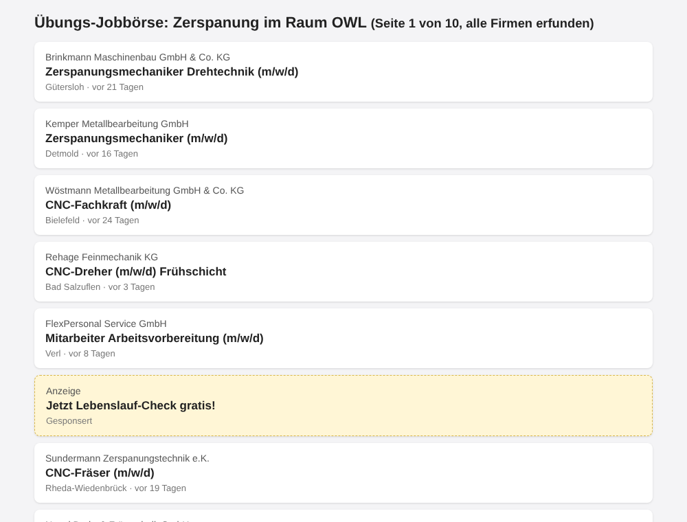

# Self-healing scraper: selectors vs. screenshots vs. both

[](https://github.com/waldemar-seibel/selfhealing-scraper/actions/workflows/tests.yml)

A small, measured experiment: three ways to extract job listings from a paginated web page with
[Playwright](https://playwright.dev/python/), and what happens when the page design changes.

* **A: selectors.** Read the DOM with CSS selectors. Fast, exact, free, and breaks on a redesign.
* **B: screenshots + LLM.** Full-page screenshots, Claude reads them and returns JSON. No selectors,
  survives a redesign, but slower, costs per page and can misread a letter.
* **C: both, self-healing.** Run A and check the result for health (also *partial* breaks, e.g.
  every card is still found but the location is suddenly empty). If something is off, ask Claude
  for new selectors, **verify** the proposal against an independent screenshot read (same count,
  matching company/title pairs, matching location and date), and only then persist it.
  If verification fails, read that page via B so no data is lost.

The target is a **local, fictional job board** generated by the repo (10 pages, 120 listings,
ads mixed in, missing fields, staffing agencies). No real website is scraped.
The user interface and console output are in German.



## Results

Measured on Windows 11, Python 3.14, model `claude-haiku-5-5`, 10 pages / 120 listings.
The C column was re-measured on 2026-11-23 with the health check and content verification described
below (Python 3.14, Playwright 1.65, one run, the repair case being the partial break `--design teil`).
A and B are unchanged. CI runs the tests on Python 3.12 and 3.13.

| | A: selectors | B: screenshot + LLM | C: self-healing |
|---|---|---|---|
| Listings found | 120 / 120 | 120 / 120 | 120 / 120 |
| Ads wrongly counted | 0 | 0 | 0 |
| Field errors | 0 | 0 in one run, 1 in another ("Gützersloh") | 0 |
| Time | ~19 s | ~55 s | ~25 s (incl. one repair) |
| Cost | 0 € | ~0.65 ct | ~0.09 ct |
| After redesign (`--design neu`) | **fails** (timeout) | works | **repairs itself** |
| After partial break (`--design teil`, only the location class renamed) | **silently loses the location** | works | **detects and repairs itself**, 120 / 120 incl. location, ~23 s, ~0.09 ct |

Three observations worth more than the table:

1. **The LLM is not deterministic.** Same screenshot, same prompt: one run was perfect, the
   other misread a town name. Evaluate LLM extraction over several runs, never one.
2. **Counting cards is not a health check.** After renaming only the location class, the first version
   of C reported "120/120 found, method A, 0 €" while the location was correct for just 6 of 120 listings
   (the 6 that really had none). C now compares each field's fill rate with its own history and caught it
   ("location filled for 0%, before 95%").
3. **An LLM proposal is a hypothesis, not a fix.** In C the proposed selectors are only accepted
   if they find the same number of listings as an independent screenshot read and every listing
   has company and title. The tests include a deliberately bad proposal (`article.karte`, which
   also matches the ad) that is correctly rejected: 13 vs. 12.

## How C decides

```
page loaded
  └─ selectors from selektoren.json find listings?
        yes ──> health check (free): fill rates per field vs. baseline.json, fields swapped?
        │         healthy ──> read (A), page joins the baseline
        │         first page ever (no baseline) and API key set? ──> check once against a screenshot
        no
        └─ screenshot finds none either ──> genuinely empty page, NO repair
  └─ something is off: repair attempts left (max 2 per run)?
        yes ──> ask Claude for selectors (trimmed HTML, scripts removed, answer validated)
        │         └─ proposal finds N listings, all with company+title, the screenshot read counts N too,
        │            and the (company, title) pairs match (fuzzy), location and date mostly match?
        │               yes ──> save selektoren.json (old version backed up, last 5 kept), baseline reset
        │               no  ──> keep old selectors, use the screenshot result for this page
        no  ──> read this page via screenshot (B)
  API down for a page ──> that page is logged as not read, the run continues
```

Every decision is written to `reparatur_log.txt`.

### What the health check can and cannot do

* It compares each field's fill rate with what was normal before (`baseline.json`, a running mean over
  healthy pages) instead of demanding fixed required fields: a missing location is fine as long as it
  was missing about as often before. It also notices when a field suddenly contains the words that used
  to appear in another field (company and title swapped).
* Without a baseline a partial break cannot be told apart from "this field never existed". That is why
  the first page is verified against a screenshot once before it becomes the baseline. Without an API key
  the baseline is unverified and C only logs a warning instead of repairing.
* A verification that reads one listing too few from the screenshot rejects a correct proposal. That costs
  one page of screenshot data, never wrong selectors.
* The thresholds (35 percentage points drop, 0.9 matching pairs, 0.85 text similarity) are reasonable
  guesses for this practice site, not tuned values.

## Run it

Windows: double-click `einrichten.bat` once (creates `.venv`, installs Playwright + Chromium,
generates the site), then `seite_starten.bat` (serves the site on `http://localhost:8000`).

```bash
python -m venv .venv && . .venv/bin/activate        # Windows: .venv\Scripts\activate
pip install -r requirements.txt
python -m playwright install chromium
python uebungsseite/erzeugen.py                     # original design
python -m http.server 8000 -d uebungsseite/site &   # Windows: seite_starten.bat

python variante_a_daten.py                          # A   (--zuschauen: slow, highlights each card)
python variante_b_screenshots.py                    # B   (--nur-bilder: screenshots only, free)
python uebungsseite/erzeugen.py --design neu        # simulate a redesign
#   other designs: teil (only the location class renamed), felder (all classes renamed),
#                  tausch (company/title classes swapped), leer (valid page without results)
python variante_c_kombi.py                          # C
python vergleich.py                                 # compare against uebungsseite/wahrheit.csv
python benchmark.py                                 # all failure patterns, simulated Claude, free
```

B and C need `ANTHROPIC_API_KEY` (environment variable or `.env` in the project folder, which
is git-ignored). A German step-by-step guide with exercises is in [ANLEITUNG.md](ANLEITUNG.md).

## Tests

```bash
pip install -r requirements-dev.txt
pytest
```

The tests run headless Chromium against a temporary copy of the practice site and **simulate
Claude**, so they need no API key, cost nothing and are deterministic. They cover: A reads all
listings and skips ads; B end to end (including a failing API call for one page); C for every design
(full redesign, partial break, renamed fields, swapped fields with and without baseline); C does *not*
repair a genuinely empty page; a healthy run makes no API call; C rejects wrong proposals (extra card,
wrong content, invalid selector) without losing data; the benchmark itself; API outages lose at most the affected page; retries
with backoff; cost tiers; HTML trimming; atomic saving and backups; the verification rules.

## Benchmark

`python benchmark.py` runs C against ten situations, each on a fresh copy of the practice site, and
compares the result with the ground truth. It measures whether C **decided correctly** (repair, do
nothing, or reject a bad proposal), whether it **did damage** (persisted a wrong or unnecessary proposal),
how many fields end up correct, and the effort (image reads, text requests, cost).

```bash
python benchmark.py                          # simulated Claude: free, no API key, repeatable
python benchmark.py --lesefehler             # the simulated screenshot read contains typos
python benchmark.py --echt --wiederholungen 3   # real Claude, ~1 ct per round, needs ANTHROPIC_API_KEY
```

Result of the simulated run (the table is also written to `benchmark_ergebnis.md`):

| Situation | Expected | C did | Damage | Fields correct |
|---|---|---|---|---|
| healthy site (control) | do nothing | nothing | no | 480/480 |
| healthy site, cold start without baseline | do nothing | nothing (one screenshot check) | no | 480/480 |
| valid page without results | do nothing | nothing | no | no listings expected |
| relaunch: cards renamed | repair | repaired | no | 480/480 |
| partial break: only location renamed | repair | repaired | no | 480/480 |
| all classes renamed | repair | repaired | no | 480/480 |
| company/title swapped | repair | repaired | no | 480/480 |
| company/title swapped, cold start | repair | repaired | no | 480/480 |
| bad proposal: ad counted as listing | reject | rejected | no | 480/480 |
| bad proposal: company/title reversed | reject | rejected | no | 480/480 |

10 of 10 decisions correct, 0 damage, 0 unnecessary repair attempts on healthy pages.

Result with **real Claude** (`python benchmark.py --echt --wiederholungen 3`, model `claude-haiku-5-5`,
2026-11-23, Windows 11, Python 3.14; the two bad-proposal situations only exist in the simulation):

| Situation | Correct decisions | Damage | Fields correct | Cost per run | Time per run |
|---|---|---|---|---|---|
| healthy site (control) | 3/3 | 0 | 480/480 | 0 ct | 3 to 6 s |
| healthy site, cold start without baseline | 3/3 | 0 | 480/480 | 0.06 ct | 8 to 11 s |
| valid page without results | 3/3 | 0 | n/a | 0.01 to 0.02 ct | 5 to 6 s |
| relaunch: cards renamed | 3/3 | 0 | 480/480 | 0.10 ct | 12 to 14 s |
| partial break: only location renamed | 3/3 | 0 | 480/480 | 0.09 ct | 9 to 11 s |
| all classes renamed | 3/3 | 0 | 480/480 | 0.09 to 0.10 ct | 11 to 14 s |
| company/title swapped | 3/3 | 0 | 480/480 | 0.10 to 0.11 ct | 11 to 13 s |
| company/title swapped, cold start | 3/3 | 0 | 480/480 | 0.11 to 0.12 ct | 11 to 13 s |

24 of 24 runs decided correctly, 0 damage, all data complete and correct, 1.76 ct in total.

What this does and does not show:

* In the simulated mode the screenshot read is perfect and the proposals are fixed, so it measures the
  **verification logic**, not how good Claude is. The ten situations were also the ones the logic was
  built against, so passing them is necessary, not sufficient.
* The real-Claude table is small: 8 situations, 3 rounds, one model, one fictional site. Claude proposed the
  right selectors on the first try every time, so a bad proposal from the real model, and the verification
  rejecting it, has not been observed. That case is covered only by the simulation. Three rounds show no
  run-to-run variation in the decisions, but too few to rule out rare misses.
* With `--lesefehler` the decisions stay identical, but the two "reject" situations drop to 470/480 fields:
  when C rejects a proposal it reads the pages through the screenshot, and the misreads end up in the data.
  Accepted repairs keep the exact DOM data (480/480).
* Rejection is expensive: two failed attempts, then every remaining page goes through the screenshot,
  about 0.67 ct instead of 0.09 ct for a successful repair.
* The test suite contains a check that the benchmark reports *damage* when the verification is disabled.

## Scope and ethics

This repo practises the technique on a site it generates itself. The same code would work on
real sites, which is exactly why it should only be used where the site's terms allow automated
access or the owner agrees. Large job portals generally prohibit it. Legitimate uses include
end-to-end tests of your own web apps, monitoring pages you are allowed to monitor, open-data
portals, and automating portals you have an account and permission for. For practising on public
sites there are dedicated sandboxes such as `books.toscrape.com`.

## License

MIT
